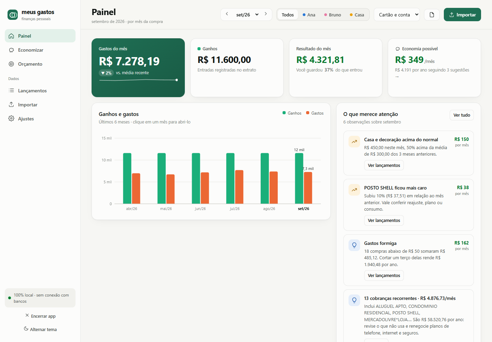
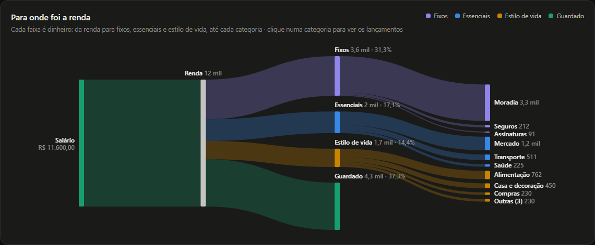
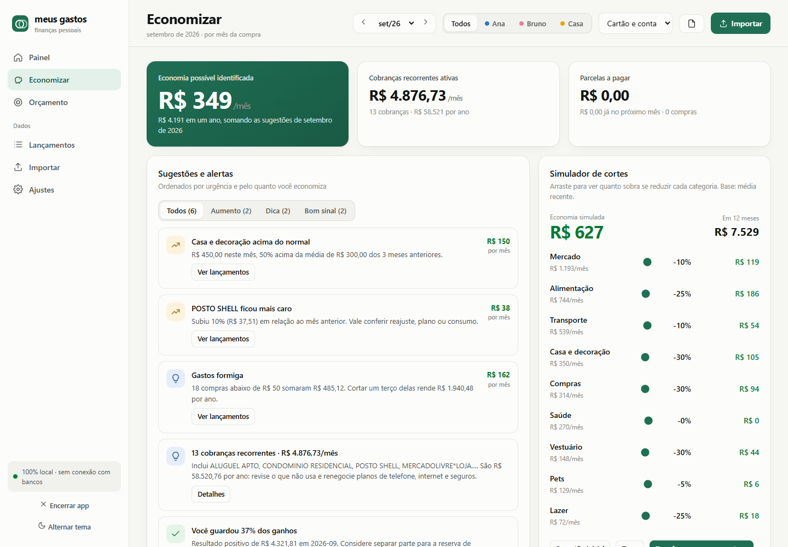
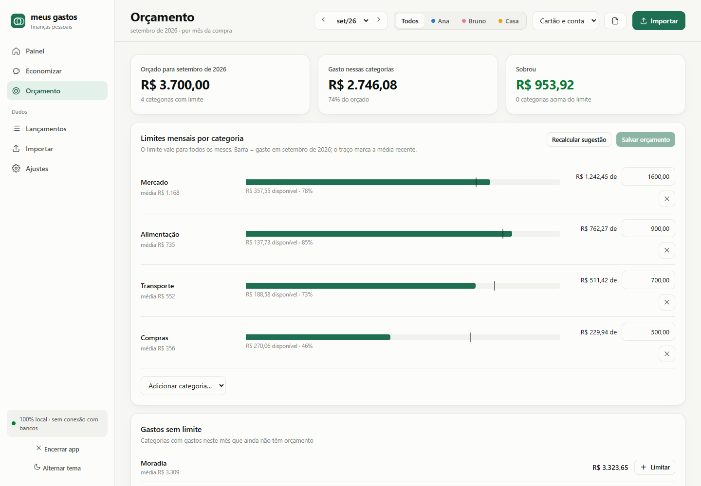
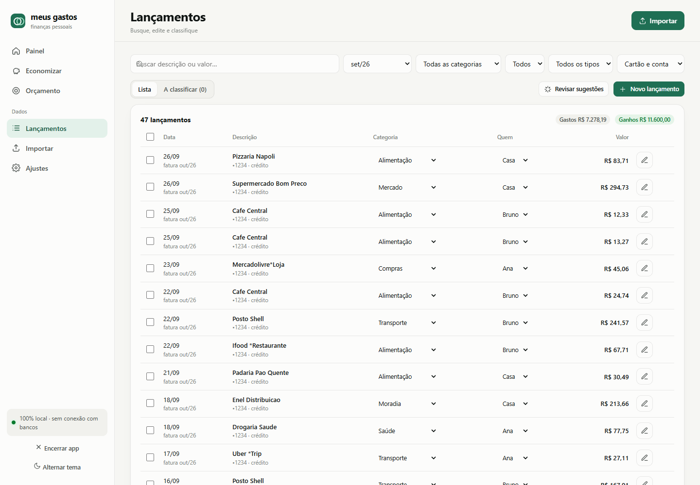
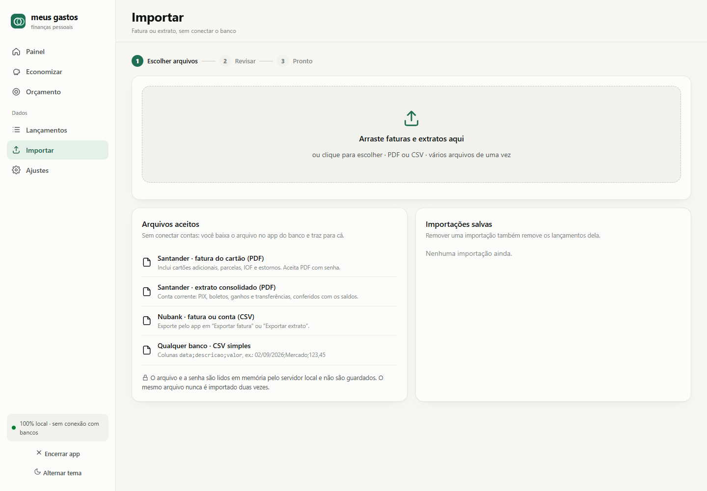
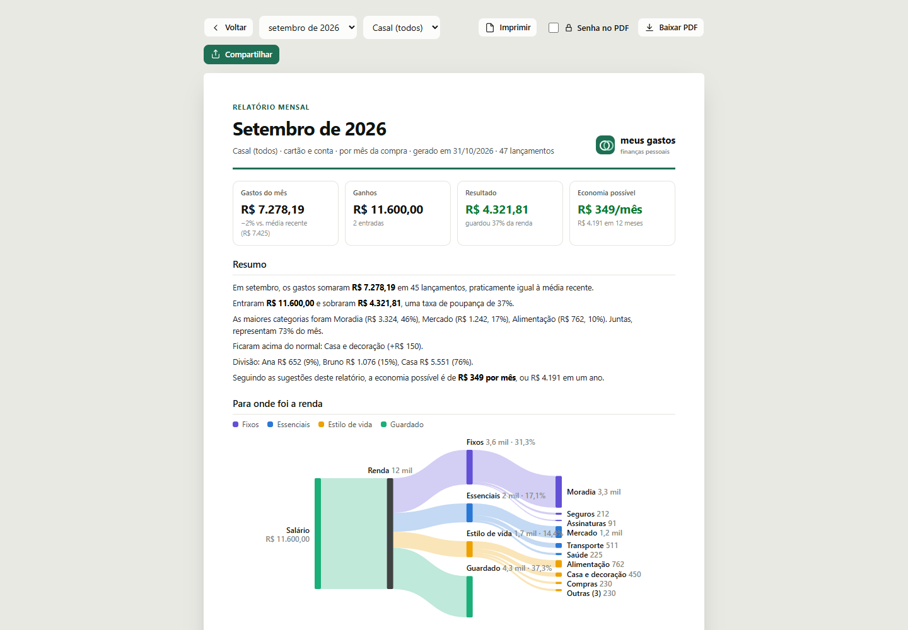
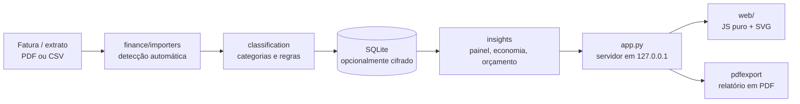

<div align="center">


# Meus Gastos

**Controle de gastos pessoal e da família que roda só no seu computador, sem conectar contas bancárias.**

[](https://github.com/ltmleo/meus-gastos/actions/workflows/ci.yml)
[](https://github.com/ltmleo/meus-gastos/releases/latest)
[](https://github.com/ltmleo/meus-gastos/releases)
[](LICENSE)


[**Baixar**](https://github.com/ltmleo/meus-gastos/releases/latest) ·
[Funcionalidades](#o-que-ele-faz) ·
[Bancos suportados](#bancos-e-formatos) ·
[Privacidade](#privacidade-e-segurança) ·
[Contribuir](CONTRIBUTING.md)

<br>



</div>

---

Você baixa a fatura do cartão ou o extrato da conta no app do banco, arrasta o arquivo para o Meus Gastos e pronto: painel do mês, para onde foi o dinheiro, onde dá para economizar, orçamento e relatório em PDF. **Nada vai para a nuvem, não há cadastro e o app não acessa a internet.**

> 🇺🇸 **English summary:** *Meus Gastos* is a free, open-source, privacy-first personal finance app for Brazilian bank statements (Santander PDF, Nubank CSV, or any bank via a simple CSV). It runs locally as a single executable, never connects to your bank, optionally encrypts your data with AES-256 and gives you a monthly dashboard, savings insights, budgets and PDF reports. Interface in Portuguese. License: AGPL-3.0.

## Por que Meus Gastos?

|  |  |
| --- | --- |
| 🔒 **100% local** | Servidor só em `127.0.0.1`. Sem conta, sem nuvem, sem telemetria, sem conexão com bancos. |
| 🔐 **Criptografia opcional** | Banco de dados cifrado com AES-256-GCM, bloqueio automático e chave de recuperação. |
| 📥 **Importa o que o banco te dá** | PDF do Santander, CSV do Nubank ou um CSV simples de qualquer banco. Detecção automática do formato. |
| 👨‍👩‍👧 **Para você, o casal ou a família** | Cada gasto tem um dono (ou é da casa) e o painel mostra quem gastou o quê. |
| 💡 **Insights que explicam o porquê** | Assinaturas, aumentos de preço, cobranças duplicadas, gastos formiga e parcelas futuras. |
| 📦 **Um único executável** | Windows, macOS e Linux. Nada para instalar além dele. |

## Baixar e usar

1. Baixe o arquivo do seu sistema na página de [**Releases**](https://github.com/ltmleo/meus-gastos/releases/latest):

   | Sistema | Arquivo |
   | --- | --- |
   | Windows 10/11 | `MeusGastos-windows.exe` |
   | macOS (Apple Silicon) | `MeusGastos-macos-arm64.zip` |
   | macOS (Intel) | `MeusGastos-macos-x64.zip` |
   | Linux (x64) | `MeusGastos-linux` |

2. Abra o arquivo. O Meus Gastos abre no seu navegador em `http://127.0.0.1:8765`.
3. Na primeira vez, diga quem vai usar (só você, casal ou família), ative a senha e importe o primeiro arquivo.

Para fechar, use **Encerrar app** na barra lateral. Abrir o executável de novo com o app rodando só reabre a aba.

<details>
<summary><b>Aviso do sistema na primeira abertura</b></summary>

<br>

Os executáveis ainda não são assinados digitalmente, então o sistema avisa:

- **Windows:** "O Windows protegeu o computador" → *Mais informações* → *Executar assim mesmo*.
- **macOS:** descompacte, clique com o botão direito em *Meus Gastos* → *Abrir* → *Abrir*.
- **Linux:** dê permissão de execução: `chmod +x MeusGastos-linux`.

Confira a integridade com o `SHA256SUMS.txt` publicado junto (`certutil -hashfile MeusGastos-windows.exe SHA256` no Windows, `shasum -a 256` no macOS/Linux).

</details>

**Onde ficam os dados:** `%LOCALAPPDATA%\MeusGastos` (Windows), `~/Library/Application Support/MeusGastos` (macOS), `~/.local/share/meusgastos` (Linux). Apagar o executável não apaga os dados.

## O que ele faz

### Painel

Gastos do mês contra a média recente, ganhos, resultado e taxa de poupança; ganhos × gastos dos últimos meses; fluxo da renda (renda → fixos, essenciais, estilo de vida, guardado → categorias); categorias com a média marcada; quem gastou; tendências; maiores compras e calendário de gastos.

<p align="center">
  
  <br><sub>Fluxo da renda, no tema escuro</sub>
</p>

### Economizar

Economia possível, alertas (cobrança duplicada, aumento de preço, categoria acima do normal, juros e IOF), simulador de cortes, assinaturas e contas fixas detectadas, parcelas já comprometidas.

<p align="center"></p>

### Orçamento

Limite mensal por categoria, sugerido pela média dos últimos meses. A barra mostra o que já foi gasto e o traço marca a média recente.

<p align="center"></p>

### Lançamentos

Busca, filtros, edição na própria tabela, seleção em massa e classificação por estabelecimento que vira regra para as próximas importações.

<p align="center"></p>

### Importar

Arraste vários arquivos de uma vez; o banco e o formato são detectados automaticamente e o total da fatura é conferido antes de salvar. O mesmo arquivo nunca é importado duas vezes.

<p align="center"></p>

### Relatório

O mês em A4, em PDF (com senha opcional), pronto para compartilhar pelo WhatsApp.

<p align="center"></p>

## Bancos e formatos

| Banco | Fatura do cartão | Conta |
| --- | --- | --- |
| Santander | PDF (com ou sem senha) | Extrato consolidado em PDF |
| Nubank | CSV exportado pelo app | CSV exportado pelo app |
| Qualquer outro | CSV simples `data;descricao;valor` | CSV simples |

```csv
data;descricao;valor
02/09/2026;Mercado;123,45
03/09/2026;Estorno;-10,00
```

Há um arquivo de exemplo em [`examples/fatura-exemplo.csv`](examples/fatura-exemplo.csv). Detalhes de cada formato em [docs/importadores.md](docs/importadores.md).

> **Seu banco não está na lista?** Abra uma [issue de novo banco](https://github.com/ltmleo/meus-gastos/issues/new/choose) ou veja [como escrever um importador](CONTRIBUTING.md#adicionar-um-banco-ou-formato). Nunca anexe faturas reais.

### Em que mês cada gasto conta

Por padrão, no **mês da compra**: a fatura que vence em outubro traz compras de setembro, que aparecem em setembro; cada parcela conta no mês em que é cobrada. O mês mais recente fica marcado como *em andamento* até a próxima fatura. Em Ajustes dá para agrupar pelo **mês da fatura**.

### Como os insights são calculados

Tudo localmente, em [`finance/insights.py`](finance/insights.py):

- **Categoria acima do normal:** pelo menos 25% e R$ 150 acima da média dos meses anteriores comparáveis.
- **Recorrência:** o mesmo estabelecimento cobra valor parecido em 3 ou mais meses.
- **Possível duplicidade:** estabelecimento, valor e data coincidem.

São observações do histórico, não recomendações de investimento.

## Privacidade e segurança

- Não conecta a bancos, não tem conta, não envia dados e não verifica atualizações sozinho.
- Servidor só em `127.0.0.1`, recusa requisições de outros sites e não grava log de uso.
- **Senha opcional** (Ajustes → *Proteger com senha*): banco cifrado com AES-256-GCM (chave derivada com scrypt), aberto só na memória enquanto desbloqueado, bloqueio automático e **chave de recuperação**. Sem senha e sem chave, ninguém recupera os dados, nem você.
- Backup e PDF podem sair criptografados.

Modelo de ameaça, decisões e como reportar vulnerabilidades: [SECURITY.md](SECURITY.md).

## Rodar a partir do código

Requer Python 3.11+.

```bash
git clone https://github.com/ltmleo/meus-gastos.git
cd meus-gastos
python -m venv .venv
.venv/bin/python -m pip install -r requirements.txt   # Windows: .venv\Scripts\python
.venv/bin/python app.py
```

No Windows, `iniciar.bat` faz tudo isso. Rodando do código, os dados ficam em `./data` (ou em `MEUSGASTOS_DATA`, se definido).

Quer explorar sem importar nada? Gere seis meses de dados fictícios (os mesmos das imagens acima):

```bash
python scripts/demo_data.py /tmp/demo/financas.sqlite3
python app.py --db /tmp/demo/financas.sqlite3
```

Testes:

```bash
python -m unittest discover -s tests -v
```

Gerar o executável localmente:

```bash
python -m pip install -r requirements-build.txt
pyinstaller meusgastos.spec
```

## Arquitetura



| Parte | Responsabilidade |
| --- | --- |
| `app.py` | Servidor HTTP local, rotas e controle de acesso |
| `finance/importers/` | Santander PDF, Nubank CSV e CSV padrão, com detecção automática |
| `finance/classification.py` | Sugestões explicáveis de categoria e regras aprendidas |
| `finance/insights.py` | Painel, economia, recorrências, parcelas e orçamento sugerido |
| `finance/vault.py`, `finance/security.py` | Cofre criptografado, sessões e bloqueio |
| `finance/repository.py` | SQLite (em arquivo ou só em memória quando criptografado) |
| `finance/pdfexport.py` | PDF do relatório via Chrome/Edge já instalados |
| `web/` | Interface em JavaScript puro, gráficos SVG próprios, sem dependências |

Apenas duas dependências em tempo de execução: [`pypdf`](https://pypi.org/project/pypdf/) e [`cryptography`](https://pypi.org/project/cryptography/).

## Contribuindo

Issues e pull requests são bem-vindos, em português ou inglês. Novos importadores de bancos são a contribuição mais valiosa. Leia o [CONTRIBUTING.md](CONTRIBUTING.md) antes de começar e lembre a regra número um: **nunca publique dados financeiros reais**, nem em prints.

- 🐛 [Reportar um bug](https://github.com/ltmleo/meus-gastos/issues/new/choose)
- 🏦 [Pedir suporte a um banco](https://github.com/ltmleo/meus-gastos/issues/new/choose)
- 🔐 Vulnerabilidades: siga o [SECURITY.md](SECURITY.md), não abra issue pública.

## Licença

[AGPL-3.0](LICENSE). Você pode usar, estudar, modificar e redistribuir; versões modificadas que forem distribuídas ou oferecidas como serviço também precisam ter o código aberto. Componentes de terceiros em [THIRD_PARTY_NOTICES.md](THIRD_PARTY_NOTICES.md).

<div align="center">
<br>
<sub>Feito no Brasil, para quem quer saber para onde foi o dinheiro sem entregar a senha do banco a ninguém.</sub>
</div>
